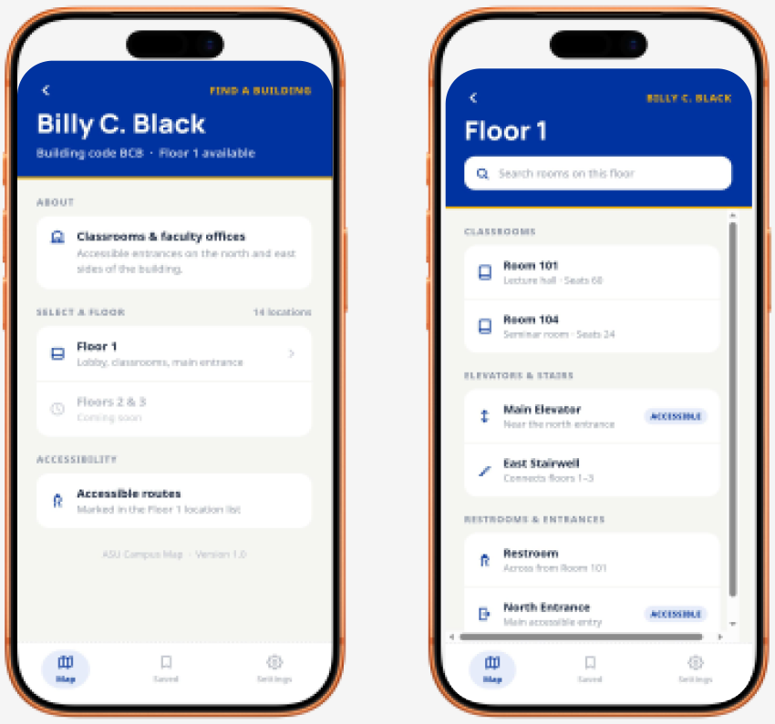
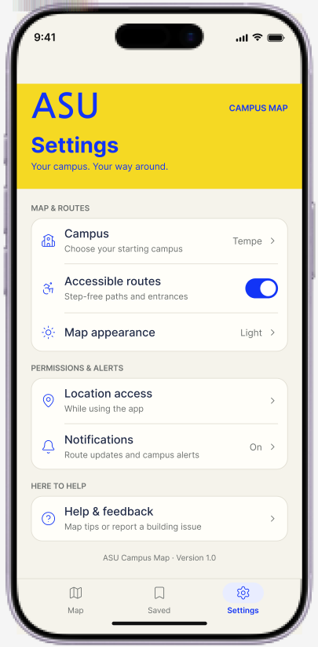

# Campus Navigator — Project 5 AI implementation prompt

**Prepared for ChatGPT · Garret Godwin · Group 1**

## Section 1. Application brief

Build Campus Navigator as a native iPhone and Android app using React Native and Expo. Its first release helps students, faculty, staff, and visitors find a room inside Albany State University's Billy C. Black Building (BCB). Give users a direct search on Home and a second path through building details and floor selection. Use the project's recorded BCB Floor 1 directory. Display the building, floor, and room, and highlight a location when its position is available on the clean illustration. If the user searches for an unknown room, show a helpful empty state.

Use the blue-and-gold ASU styling from the attached Figma references and keep Map, Saved, and Settings within reach in the bottom navigation. Support saving a room, opening it from Saved, and changing the app's appearance. Keep those preferences on the device.

## Section 2. Product vision statement from Project 1

> FOR students, faculty, staff, and visitors WHO need an easier way to locate classrooms and offices on campus, THE Campus Navigator is a campus navigation application THAT allows users to search for classrooms, offices, and other campus locations and receive information to help them find their destination. UNLIKE relying on campus signs, printed maps, or asking others for directions, OUR PRODUCT will provide a simple and convenient way to search for specific campus locations.

[Group 1 Project 1 vision](https://github.com/CSCI4221ASU/Fall26_G1/blob/03fe93938b78b1cc9a6d371743aeaa3db26e27d7/README.md#part-1---work-done-by-each-member)

## Section 3. Prototypes from Project 2

| Contributors | Prototype | Use in the native app |
| --- | --- | --- |
| Garret Godwin | Settings screen | Gold header, blue accents, grouped preference rows, and bottom navigation. Implement the campus display and a working light/dark preference. [Design notes](../Project-2/figma_settings_prototype.md) |
| Garret Godwin | Express and SQLite backend prototype | Reuse the directory developed for the building and indoor-location API. [Backend prototype](../Project-2/backend_prototype.md) |
| Jada Rodgers and Amirah Muhammad | Main search, building results/details, floor selection, and location list | Use the shared search → building → floor → location flow. Implement BCB Floor 1 using recorded data. [Frontend prototype](https://github.com/CSCI4221ASU/Fall26_G1/blob/03fe93938b78b1cc9a6d371743aeaa3db26e27d7/Project2/jada/Project-2/Front_End_Prototype.md) |
| Amirah Muhammad | BCB interior mockup and connections between floors, documented during Project 3 | Use the BCB interior as design context. Floor 2 data remains outside this release. [Interior design notes](https://github.com/CSCI4221ASU/Fall26_G1/blob/03fe93938b78b1cc9a6d371743aeaa3db26e27d7/Project3/Amirah/amirahminutes_3.md) |

Use the prototype images for layout and color. Use the repository's directory for actual room numbers. Data-dependent prototype controls for step-free routes, live location, and alerts require separate implementation before they can be offered.

## Section 4. Features, persona, scenario, and user story from Project 3

| Artifact | Requirement | Source |
| --- | --- | --- |
| Feature | Classroom Search accepts a room number and building name or abbreviation. Results identify the building and floor. Selecting a result opens the room and highlights it where a map position is available. Preserve directory details when a marker is unavailable. | [Classroom Search](../Project-3/feature.md) |
| Persona | Dr. Phillip Journey is a newly hired ASU cybersecurity professor who is comfortable using a smartphone and unfamiliar with the campus layout. | [Persona](../Project-3/persona.md) |
| Scenario | Dr. Journey checks his schedule before class, searches for the building abbreviation and room number, and uses the floor and highlighted room location to find his classroom. | [Finding an Assigned Classroom](../Project-3/scenario.md) |
| User story GP-1-1 | As a new professor, I want to search for my assigned classroom using its room number and building so that I can find the correct floor and room inside the building before my class begins. | [User story](../Project-3/user_story.md) |
| Team frontend work | Jada documented implementing the building details, floor selection, floor list, and Settings. Amirah documented the BCB interior mockup. | [Jada's progress](https://github.com/CSCI4221ASU/Fall26_G1/blob/03fe93938b78b1cc9a6d371743aeaa3db26e27d7/Project3/Jada/Project-2/JadaG1_minutes_4.md), [Amirah's progress](https://github.com/CSCI4221ASU/Fall26_G1/blob/03fe93938b78b1cc9a6d371743aeaa3db26e27d7/Project3/Amirah/amirahminutes_3.md) |

Garret's is the only complete feature, persona, scenario, and user-story set found in the cloned Group 1 Project 3 folder. The other members' available notes are linked above.

## Section 5. Architecture from Project 4 and implementation requirements

Project 4 specified a layered client–server design. React presents the building and room screens. Express handles building search, locations, and map requests. The API reads SQLite. In the database, `buildings` owns `locations`, while `maps` has many `map_destinations` keyed by map ID and destination ID. Workbook measurements and unconfirmed observations have separate tables. The proposed deployment runs the API on one host with persistent SQLite storage. [Project 4 architecture](../Project4/architecture.md)

For the Project 5 native demo:

- Put the Expo source, app config, and lockfile in `mobile/`. Use React Native components for Home, Building, Floor, Room, Saved, and Settings. Home must let users tap a building and tap Settings.
- Bundle [the existing BCB destination directory](../data/bcb-level-1-destinations.json) and [the clean floor plan](../client/bcb-floor-1-clean.png) so the mobile app can demonstrate search offline. The React web client may continue using Express. Keep SQLite on the server.
- Share [the illustrated map geometry](../client/map-points.js) with the web app. Display 128 through 116 as one row, 133 above 135, 141 between 139 and 143, and 142 beside the auditorium. Display room details for locations with no confirmed marker. Use the clean illustration throughout the app.
- Persist saved rooms and appearance with AsyncStorage. Handle empty search results and use readable native controls.
- Provide local start instructions for iPhone and Android and export both platform bundles. Demonstrate a building tap, a Settings tap, and a search for BCB 119. Live indoor positioning and turn-by-turn routing are outside this release.
